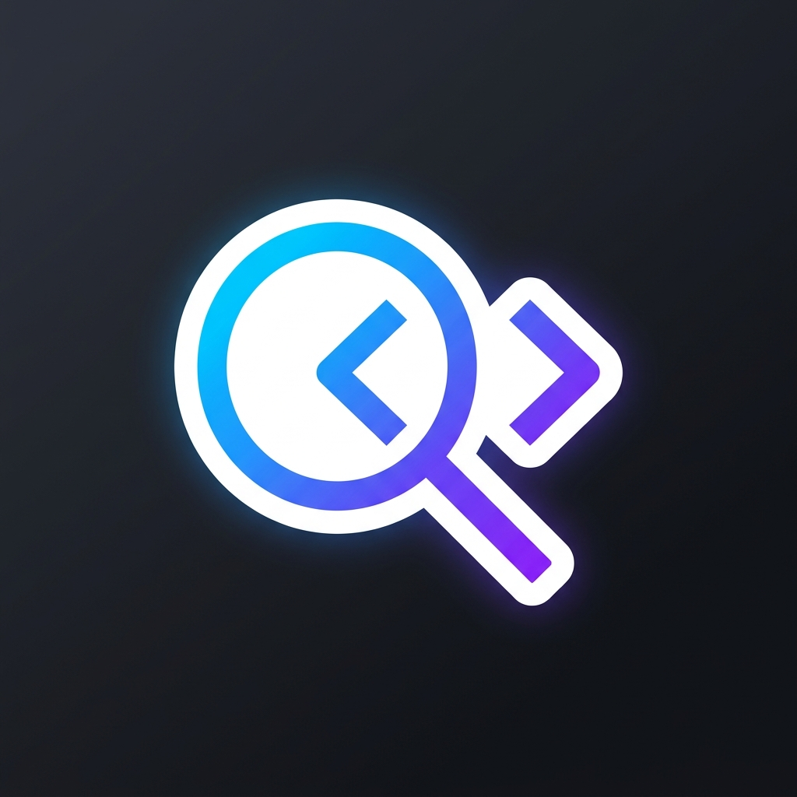
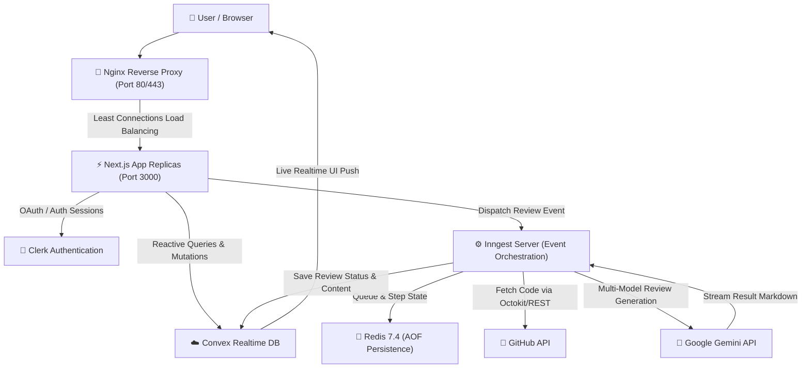

<p align="center">
  
</p>

<h1 align="center">CodeLens AI</h1>

<p align="center">
  <strong>Supercharge your code reviews with AI.</strong><br>
  Analyze GitHub repositories to detect bugs, enforce best practices, optimize performance, and spot security vulnerabilities before merging into production.
</p>

<p align="center">
  
  
  
  
  
  
  
  
</p>

---

## 📌 Table of Contents

- [Overview](#-overview)
- [Architecture & Workflow](#-architecture--workflow)
- [Core Features](#-core-features)
- [Tech Stack](#-tech-stack)
- [Getting Started](#-getting-started)
  - [Prerequisites](#prerequisites)
  - [Environment Setup](#environment-setup)
  - [Running Locally](#running-locally)
- [Docker & Horizontal Scaling](#-docker--horizontal-scaling)
- [Project Structure](#-project-structure)
- [Security & Hardening](#-security--hardening)

---

## 🔭 Overview

**CodeLens AI** is an intelligent developer tool that connects directly to your GitHub account to review your code. It acts as an automated senior software engineer, analyzing code line by line and providing actionable markdown feedback divided into:

1. **Potential Bugs**: Race conditions, edge cases, and logical errors.
2. **Performance Issues**: Memory leaks, unnecessary re-renders, and algorithm inefficiencies.
3. **Security Vulnerabilities**: Injection flaws, improper sanitization, and insecure patterns.
4. **Best Practices & Readability**: Naming conventions, style guides, and maintainability.

---

## 🏗 Architecture & Workflow



---

## ✨ Core Features

- **🐙 Native GitHub OAuth Integration**: Browse repositories (public & private) and view commit trees seamlessly.
- **⚡ Background Durable Execution**: Reviews run as durable Inngest step-functions with automatic retries and failure handlers.
- **🛡 Multi-Model AI Fallback Chain**: If the primary Gemini model encounters rate limits or high demand, it automatically cascades through fallbacks:
  `gemini-flash-latest` $\rightarrow$ `gemini-3.5-flash` $\rightarrow$ `gemini-2.5-flash` $\rightarrow$ `gemini-omni-1.1-flash` $\rightarrow$ `gemini-2.5-pro`.
- **⚡ Reactive Live Updates**: Backed by Convex — review statuses update in realtime without needing manual page refreshes.
- **🔐 Quota Management & Pro Tier**: Free tier review limiting with Pro Plan membership via Clerk organization/plan gating.
- **🐳 Enterprise Docker Architecture**: Zero-CVE Chainguard base images, distroless runtime, and Nginx reverse proxy with load balancing.

---

## 🛠 Tech Stack

| Layer | Technologies |
|---|---|
| **Frontend** | [Next.js 15 (App Router)](https://nextjs.org), [React 19](https://react.dev), [Tailwind CSS v4](https://tailwindcss.com), [Lucide Icons](https://lucide.dev) |
| **Authentication** | [Clerk](https://clerk.com) (GitHub Social Login, User Management, Billing Metadata) |
| **Backend & DB** | [Convex](https://convex.dev) (Type-safe reactive backend database and server functions) |
| **Job Queue / Workers** | [Inngest](https://www.inngest.com) (Event-driven background orchestration) |
| **AI Engine** | [Google Gemini](https://ai.google.dev) (`@google/genai`) |
| **Caching & State** | [Redis 7.4](https://redis.io) (Inngest durable state persistence) |
| **Proxy & Gateway** | [Nginx Alpine](https://nginx.org) (SSL termination, rate limiting, least-conn load balancing) |
| **Containerization** | Docker, Docker Compose, Chainguard (0-CVE build base), Google Distroless |

---

## 🚀 Getting Started

### Prerequisites

- [Node.js 20+](https://nodejs.org) or [Bun](https://bun.sh)
- [Docker Desktop](https://www.docker.com/products/docker-desktop) (for containerized runs)
- Accounts with **Clerk**, **Convex**, and **Google AI Studio**

### Environment Setup

Create a `.env.local` file in the root directory (refer to `.env.example`):

```bash
cp .env.example .env.local
```

Populate the required secrets:

```env
# Convex
NEXT_PUBLIC_CONVEX_URL=https://your-deployment.convex.cloud
CONVEX_DEPLOYMENT=dev:...

# Clerk
NEXT_PUBLIC_CLERK_PUBLISHABLE_KEY=pk_test_...
CLERK_SECRET_KEY=sk_test_...
CLERK_WEBHOOK_SECRET=whsec_...
NEXT_PUBLIC_CLERK_SIGN_IN_URL=/sign-in
NEXT_PUBLIC_CLERK_SIGN_IN_FALLBACK_REDIRECT_URL=/dashboard

# Google Gemini
GEMINI_API_KEY=AIzaSy...

# Inngest (Defaults to local Docker/CLI server)
INNGEST_EVENT_API_URL=http://localhost:8288
```

### Running Locally

```bash
# 1. Install dependencies
bun install
# or
npm install

# 2. Start Convex backend in one terminal
npx convex dev

# 3. Start Next.js development server
bun dev
# or
npm run dev
```

Visit [http://localhost:3000](http://localhost:3000) to view the application.

---

## 🐳 Docker & Horizontal Scaling

The application includes a production-ready, security-hardened Docker Compose environment designed for high availability.

### Spin up the full stack:

```bash
docker compose --env-file .env.local up --build -d
```

This launches **5 containers**:
- **`nginx-1`**: Entry gateway on port `80`/`443`.
- **`nextjs-app-1` & `nextjs-app-2`**: 2 Next.js replicas load-balanced by Nginx.
- **`inngest-server-1`**: Orchestrates background code review pipelines.
- **`redis-1`**: In-memory event store with AOF persistence.

### Horizontal Pod / Container Scaling

Scale Next.js application replicas dynamically on the fly:

```bash
# Scale up to 4 replicas under traffic surges
docker compose up -d --scale nextjs-app=4

# Scale down to 1 replica to save resources
docker compose up -d --scale nextjs-app=1

# View live container health
docker compose ps
```

---

## 🔒 Security & Hardening

- **Zero-CVE Build Pipeline**: Base images use `cgr.dev/chainguard/node:latest-dev` and runner uses `gcr.io/distroless/nodejs22-debian12`, eliminating all shell and OS-level attack vectors.
- **Principle of Least Privilege**:
  - Non-root user execution (`nonroot:65534`).
  - Dropped Linux capabilities (`cap_drop: ALL`).
  - Read-only root file systems (`read_only: true`).
  - `no-new-privileges: true` flag enabled on all containers.
- **Reverse Proxy Protection**:
  - Nginx enforces strict **Content Security Policy (CSP)**, `SAMEORIGIN` framing restrictions, and referrer privacy.
  - Rate limiting enabled (`30 r/s` for API endpoints, `60 r/s` for general traffic).
  - Dangerous Redis commands (`FLUSHALL`, `CONFIG`, `DEBUG`) disabled.

---

## 📁 Project Structure

```
CodeLens/
├── app/                      # Next.js App Router (pages & API routes)
│   ├── (auth)/               # Authentication route group (sign-in)
│   ├── (root)/               # Main application pages (dashboard, review)
│   └── api/inngest/          # Inngest webhook endpoint
├── components/               # Modular UI components
│   ├── home/                 # Landing page sections & header
│   ├── navigation/           # Dashboard app headers & navigation
│   ├── review/               # Code viewers & markdown renderers
│   └── provider/             # Convex & Clerk context providers
├── convex/                   # Convex realtime database schema & queries
│   ├── schema.ts             # User & review table schemas
│   ├── review.ts             # Review CRUD functions
│   └── users.ts              # Clerk user webhook synchronization
├── inngest/                  # Event-driven workflow definitions
│   ├── client.ts             # Inngest client
│   └── function.ts           # Durable code review step function & Gemini logic
├── nginx/
│   └── nginx.conf            # Reverse proxy, SSL, and load balancer rules
├── services/                 # GitHub API & token services
├── Dockerfile                # Multi-stage zero-CVE build
├── docker-compose.yml        # Multi-container orchestration
└── tsconfig.json             # TypeScript configuration
```

---

## 📄 License

This project is open-source and available under the [MIT License](LICENSE).
